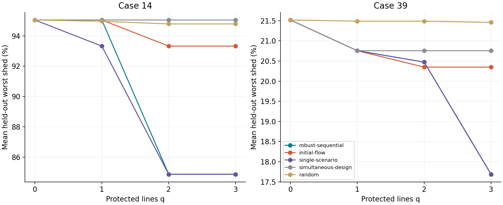
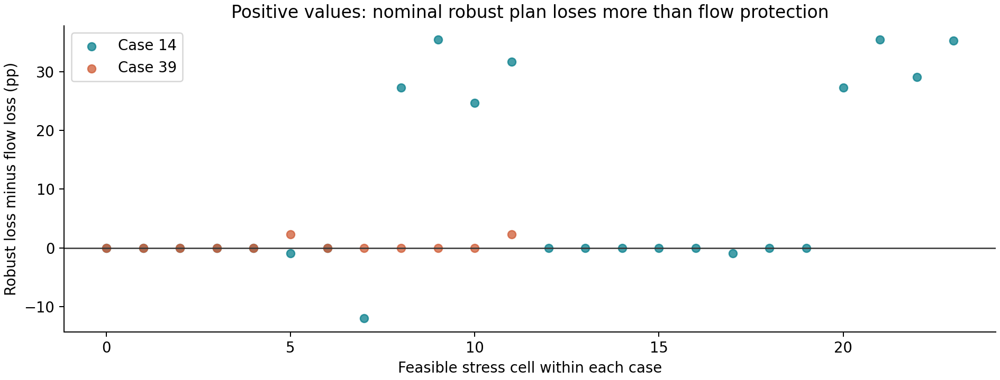
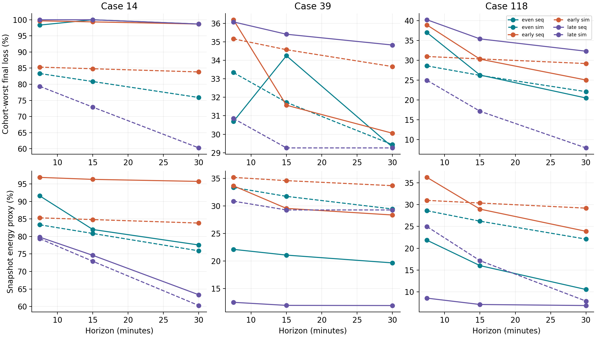
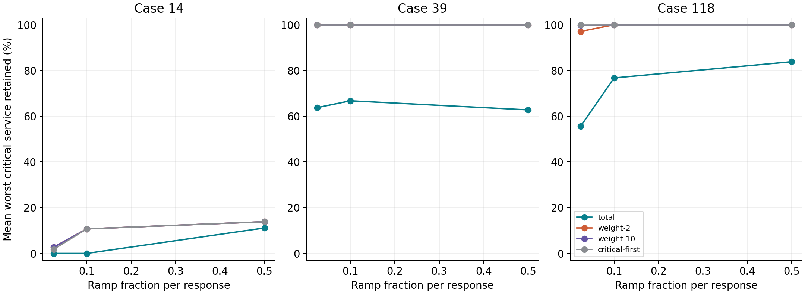

Full project report for CS637

Paper explanation, implementation audit, experiments, limitations and future work

## Study provenance

Group repository: AlankritGupta584/sequin-python-reproduction. Upstream commit e03e8495fb67af50f00c52daa75908e34960f151. Local branch: extensions-study.

Prepared on 29 October 2026. All extension measurements in this report were recomputed using the group repository's SciPy defender. The earlier project's results were not relabelled as new experiments.

Selected paper: Andrew Chio, Russell Bent, Kaarthik Sundar and Nalini Venkatasubramanian. SEQUIN: A Network Science and Physics-based Approach to Identify Sequential N-k Attacks in Electric Power Grids. ACM/IEEE ICCPS 2025. DOI 10.1145/3716550.3722029. [1]

Evidence: complete CSV results, source/scenario hashes, exact small-instance outage tables, matched comparison probes, saved demonstrations and independent validation are included in the project folder.


# 1. Executive explanation

Imagine a power network as roads carrying electricity. Removing one road changes the routes and how much each power station must produce. If another road fails after the operator has adjusted, the result can differ from removing both roads together. SEQUIN searches for damaging orders of line failures using network clues and a constrained model of the operator's response.

The group already implemented this core idea in plain Python. The current work studies what an operator can do with that information: protect a limited set of lines, account for different response intervals, and give selected services a higher priority. These answer preparedness, timing and service-allocation questions respectively.

| Case | q=2 protection | Mean test worst loss | Reduction vs no defense |
| --- | --- | --- | --- |
| 14 | robust-sequential | 84.87% | 10.17 pp |
| 14 | initial-flow | 93.32% | 1.72 pp |
| 39 | robust-sequential | 20.47% | 1.04 pp |
| 39 | initial-flow | 20.35% | 1.17 pp |

Protection improves the no-defense reference in these examples, but the scenario-based plan does not beat every baseline. Timing changes both the final MW loss and the time-weighted snapshot proxy. Priority policies can improve selected services, often by sacrificing other demand. The later sections report ties and adverse cases as well as gains.

The fresh suite contains 1,648 protection rows, 1,728 timing rows and 23,296 priority rows. These are deterministic evaluations within a small number of demand scenarios, not that many independent experimental samples.

## Reading route

Sections 2-4 explain the paper and code. Sections 5-6 establish model differences and experimental fairness. Sections 7-12 explain the three extensions and their results. Sections 13-17 cover correctness, conclusions, future work and reproduction.


# 2. What the paper contributes

## Sequential N-k interdiction

N is the number of components in a network and k is the failure budget. Here only transmission lines fail. The attacker chooses an ordered sequence of distinct lines. After every failure, the defender redispatches generators and, if necessary, sheds demand. Failed lines and previously lost service remain lost. The attacker seeks the largest final load shed. [1, Section 3]

The operator is myopic: it optimizes the present response without knowing the next outage. This is different from solving one multi-period plan with perfect knowledge of future failures. The history matters because later ramp bounds depend on current generation and later service bounds depend on which demand has already been lost.

## Physics and network science

The defender enforces a DC approximation of AC power flow, nodal power balance, branch ratings, generator limits and ramp allowances. DC here names a linearized power-flow approximation. It does not mean the benchmark is a physical DC grid. It neglects losses and voltage/reactive-power dynamics.

The paper's Guided Exploration uses high flow, branch/generator flexibility, transmission width and load density to shortlist candidates. It evaluates cut impact by solving a defender response and chooses promising continuations. Its impact-reasoning stage groups common ordered prefixes to expose where losses grow. The active group implementation uses the released-style top-flow shortlist rather than every property in the printed algorithm. [1, Algorithm 1; 2]

## Why the search is difficult

m available lines create m!/(m-k)! ordered sequences. Case 14 has 20 lines: k=2 gives 380 sequences. Case 39 has 46 lines: k=2 gives 2,070, while k=3 already gives 91,080. Each prefix needs an optimization response. Network screening reduces search work but can miss damaging sequences.

The paper's main strength is combining outage order with a constrained operating response. Its exact numerical outcomes depend on modeling details, randomized inputs and the selection among equally good operator dispatches. Reproduction should separate those issues from the quality of the attack search.


# 3. The group model, from input to response

| Stage | Code | What it does |
| --- | --- | --- |
| Read case | grid_model.load_case | Parses bus, generator, branch and cost matrices. Optional seeded perturbation multiplies positive Pd only. |
| Initial operating point | grid_model.initial_state | Least-cost intact-grid DC LP using scipy.optimize.linprog. |
| Choose failure | search_methods.py | Exact, greedy or guided logic selects a line or complete attack sequence. |
| Operator response | grid_model.defend | A MILP maximizes served MW subject to the surviving network, ramp windows and optional shutdown. |
| Carry state | search_methods.run_sequence | Passes generation and served load into the next round. |
| Measure loss | grid_model.shed_pu | Divides lost MW by baseMVA. New extension exports use explicit MW. |

## Variables and constraints

The response model has bus angle theta, generator MW output p, binary generator switch z, served MW s at each bus, and MW flow f on each surviving line. Removing a line removes its flow-angle equation and its flow variable from the active-line formulation. One bus angle is fixed in each connected island.

```text
f_ij = baseMVA / (x_ij * tap_ij)
       * (theta_i - theta_j - phase_shift_ij)
Generation + fixed injections - served demand
       = net outgoing flow
0 <= s_i(new) <= s_i(previous)
low_g = max(0, previous_p_g - alpha * Pmax_g)
high_g = min(Pmax_g, previous_p_g + alpha * Pmax_g)
low_g * z_g <= p_g <= high_g * z_g
```

A generator can either operate inside its current ramp window or shut off completely. Shutdown is recourse in this steady-state model, so an emergency switch-off can bypass a gradual downward ramp. The group recreates z every round and does not carry a no-restart constraint. A previously zero-output unit can therefore return within the next upward allowance. The paper describes persistent shutdown in Eq. 2f; that distinction is retained and disclosed.


# 4. Search methods and existing limitations

| Method | Selection rule | Scope |
| --- | --- | --- |
| Exact simultaneous | Enumerate unordered sets and apply one defender response. | All sets at a tractable k; one response opportunity. |
| Exact sequential | Enumerate ordered sequences, responding after each cut. | All ordered sequences at a tractable k. |
| Greedy-FLOW | Remove the current largest absolute-flow line. | One selected continuation each round. |
| Greedy-IMPACT | Evaluate every remaining line and choose largest immediate shed. | One-step loss optimization, no future lookahead. |
| Guided | Try top-flow starts. Later evaluate cut impact only in the top-N current-flow shortlist. | Best of these guided paths, generally heuristic. |
| Permutation | Enumerate orders of a specified line set. | All orders of that set, not all possible sets. |

network_metrics.py computes generator flexibility, branch thermal margin, local load density and a greedy edge-disjoint-path width heuristic. The group's width routine is not a max-flow certificate. Its local density is not the paper's equal-width clustered density. The active guided search uses current flow and immediate cut impact, so the helper differences do not directly drive that shortlist.

run_tests.py is a reproduction experiment driver rather than a unit-test suite. check_results.py asserts specific error thresholds against released reference CSVs. The historical README and implementation notes make some exact-match claims, while the current driver tests broader cases with different accuracy thresholds. Fresh output should take precedence over historical prose.

Several original search paths skip None responses, and exact search iterates all branch rows even if a supplied future case has inactive lines. The new evaluator restricts failures to initially available lines and raises on failed response optimization. It adds complete ordered-prefix caching. Caching by the unordered failed set would be wrong because different failure orders can produce different dispatch and service states.


# 5. How this differs from the earlier project

| Aspect | Group reproduction | Earlier sequin package |
| --- | --- | --- |
| Units and solver | MW, SciPy, dense rows | Per-unit, highspy, sparse rows |
| Shutdown | Fresh generator binary each round | Persistent online state; no restart |
| Dispatch ties | Single service objective by default | Service objective followed by economic tie-break |
| MILP gap | Default HiGHS relative gap | Explicit 1e-8 relative gap |
| Angles | Every angle in [-pi,pi] plus island reference | Branch difference bounds plus island reference |
| Negative Pd | Fixed injection in every response | Curtailable, nonrecoverable injection after initialization |
| Random draw | Positive Pd entries only | Factors for all buses and negative injections |
| Main guided search | Top current-flow shortlist | Multiple properties, plus separate released-style method |

Identical seed integers do not guarantee identical load vectors across these implementations because they consume random draws differently. The matched model comparison therefore uses no demand perturbation and reads exactly the same case files. The six supplied cases all have zero active shunts and zero quadratic cost terms, so those generic capability differences cannot explain the measured six-case discrepancies.

| Fixed attack | Group MW | Earlier MW |
| --- | --- | --- |
| Case 14: (3,1) | 439.970 | 462.970 |
| Case 39: (14,46) | 2,093.920 | 2,093.920 |
| Case 118: (104,97) | 531.398 | 1,192.347 |
| Case 240: (437,433,436) | 21,933.806 | 21,937.294 |

These are selected fixed-sequence probes, not an overall quality ranking. Initial generator dispatch agrees almost exactly on five cases. Case 60 has a maximum individual-generator difference of 720 MW. The comparison does not isolate a unique cause for that difference; dispatch degeneracy is a plausible contributor. The group cost-tie probe also changes MIP precision, so it cannot attribute every change solely to the tie-break.

Backward compatibility: 26 prefix-state probes compare the extended defender with the untouched source loaded from the upstream Git commit. The largest generation or served-load difference is 0.0 MW. This is direct compatibility evidence for the tested probes, not every possible input.


# 6. Critique and evaluation design

| Limitation or practical gap | Implemented response | Remaining scope |
| --- | --- | --- |
| Identifies vulnerability without selecting investment | Budgeted line protection and adaptive re-evaluation | Ideal protection, equal costs, small finite design set |
| Fixed response epochs | Variable windows and equal decision opportunities | Snapshot proxy, no continuous ramp trajectory |
| Total MW treats service types equally | Weighted and critical-first service policies | Synthetic priority groups, no real critical-facility data |
| Heuristic attack search may miss harm | Complete pairs on small cases and shared targeted cohorts | Larger cases remain sampled worst-found results |
| A nominal plan may fail under shifted conditions | Held-out seeds and demand/ramp stress | Small scenario ensemble, no stochastic guarantee |
| DC steady states omit dynamics | Explicit assumptions and scoped conclusions | No AC, transient, relay or frequency validation |

## Fair comparisons

The group response engine supplies every extension solve. Protection uses design demand seeds 0,1,2 and tests on unseen seeds 100-104. Test outcomes never choose the plan. Timing freezes attack orderings before comparing spacing, horizon and simultaneous/sequential policies. Priority evaluates every policy on exactly the same sequence set and starts from the same economic dispatch.

A separate total-tight policy requests the same relative MIP gap as the new priority objectives. This checks whether apparent priority benefits survive a more precise aggregate-service reference. The original total-service results remain available to show continuity with the group code. Numerical precision can alter intermediate dispatches in a sequential problem, so its effects need not stay small at the final round. [3,4]

Statistics use demand scenarios as the unit. Five held-out seeds support descriptive paired bootstrap intervals, not broad significance claims. Thousands of deterministic attack rows do not become thousands of independent demand experiments. Groups at different fractions vary both count and membership and are not guaranteed nested.


# 7. Extension 1: scenario-aware protection

Practical question: if only q lines can be made resistant to the modeled failure, which ones should be chosen? The attacker then adapts to the remaining eligible lines. Protecting the original worst attack alone would miss replacement attacks, so every plan is evaluated against all eligible ordered pairs.

```text
For design scenarios s and protected set P:
  loss_s(P) = max loss_s(ordered outage a), a disjoint P
  choose |P| = q to minimize max_s loss_s(P)/demand_s
Greedy step:
  evaluate every additional eligible protected line
  minimize worst design fraction, then mean, then line ID
```

Complete k=2 outage tables store each ordered sequence and its group-model loss. Protection only changes outage eligibility, not a surviving sequence's physical constraints. Filtering rows containing protected lines is therefore equivalent to rerunning the finite eligible attack set under the same deterministic policy. Independent fresh exhaustive replay verifies this on held-out cases.

| Protocol | Settings |
| --- | --- |
| Cases and outage budget | Cases 14 and 39, k=2; 380 and 2,070 ordered pairs per demand scenario. |
| Protection budgets | q=0,1,2,3; exact outer enumeration additionally at q<=2. |
| Design/test demands | +/-5% positive-Pd draws, design seeds 0/1/2, test seeds 100-104. |
| Baselines | 20 random nested plans, mean initial flow, unweighted edge betweenness, single-scenario design, simultaneous-outage design, exact finite outer design. |
| Stress | Freeze nominal plans; ramp 0.025/0.1/0.5 and demand spread 0%/15%, seeds 100/101. |

This is a course-project extension of SEQUIN, not a claim to invent defender-attacker-defender protection. The paper itself identifies ruggedization as future work and cites related interdiction-defense research. [1, Section 6]


# 8. Protection results and generalization



| Case | q | Robust | Flow | Single | Sim design | Random |
| --- | --- | --- | --- | --- | --- | --- |
| 14 | 0 | 95.04% | 95.04% | 95.04% | 95.04% | 95.04% |
| 14 | 1 | 95.04% | 95.04% | 93.32% | 95.04% | 94.96% |
| 14 | 2 | 84.87% | 93.32% | 84.87% | 95.04% | 94.79% |
| 14 | 3 | 84.87% | 93.32% | 84.87% | 95.04% | 94.79% |
| 39 | 0 | 21.52% | 21.52% | 21.52% | 21.52% | 21.52% |
| 39 | 1 | 20.75% | 20.75% | 20.75% | 20.75% | 21.49% |
| 39 | 2 | 20.47% | 20.35% | 20.47% | 20.75% | 21.49% |
| 39 | 3 | 17.69% | 20.35% | 17.69% | 20.75% | 21.46% |

Values are mean held-out scenario worst loss as a percentage of positive demand. Each random value first averages 20 plans within its demand seed. Smaller is better. The adaptive sequence may differ for every plan and scenario.

Case 14: the robust q=2 plan materially reduces loss relative to no protection and the flow baseline. At q=1 its held-out gain is absent, while the single-scenario plan does better on these test seeds. Case 39: flow does slightly better at q=2, while robust protection gains more at q=3. The scenarios and budgets therefore determine which design is best.

| Case | q | Mean reduction (pp) | Descriptive 95% bootstrap interval |
| --- | --- | --- | --- |
| 14 | 2 | 10.17 | [9.54, 10.62] |
| 14 | 3 | 10.17 | [9.54, 10.62] |
| 39 | 2 | 1.04 | [0.33, 2.24] |
| 39 | 3 | 3.83 | [3.48, 4.22] |

The interval resamples only five held-out demand seeds, with pairing against the corresponding no-protection loss. It describes this small synthetic sample and should not be presented as a certificate of real-grid performance.


# 9. Protection stress and design optimality



The robust plan loses more than flow protection in 10 of 36 feasible stress configuration cells. Its largest excess is 35.48 percentage points. A positive point in the plot is a failure to outperform that baseline. Repeated zero-perturbation seeds have identical demands and are not independent draws.

Of 144 requested policy rows, 108 are feasible-start evaluations and 36 record initial infeasibility. The perturbed case-39 starting operating points cannot always supply all demand before any failure. No attack loss is fabricated for those cases, and the study does not resample until it finds an easier starting point.

| Case | q | Greedy design % | Exact design % | Gap (pp) |
| --- | --- | --- | --- | --- |
| 14 | 0 | 95.1016 | 95.1016 | 0.000000 |
| 14 | 1 | 95.1016 | 95.1016 | 0.000000 |
| 14 | 2 | 86.0193 | 86.0193 | 0.000000 |
| 39 | 0 | 20.8995 | 20.8995 | 0.000000 |
| 39 | 1 | 20.3876 | 20.3876 | 0.000000 |
| 39 | 2 | 20.3876 | 20.3876 | 0.000000 |

Exact design means all protection sets at the shown budget, evaluated on the finite training scenarios and all finite outage pairs. It does not mean exact protection against every possible demand or dispatch tie. Greedy can tie this oracle on these small instances and still generalize differently from flow protection on held-out seeds.

Future improvement: include demand spread and response-speed uncertainty inside the design objective, rather than only stress-testing a plan trained at one ramp setting. Add realistic line-specific costs and imperfect hardening success before treating the plan as an investment recommendation.


# 10. Extension 2: response-window model

Practical question: does it matter how quickly failures arrive and how long the operator can respond? The paper uses fixed epochs. This extension scales each response's ramp allowance by its duration and holds the total observation horizon fixed when comparing event patterns.

| Pattern | Windows at H=15 minutes | Interpretation |
| --- | --- | --- |
| Even | 5, 5, 5 | Equal response windows. |
| Early cluster | 1, 1, 13 | Short early opportunities followed by a long final window. |
| Late cluster | 13, 1, 1 | Long initial response, then rapid later failures. |

```text
Reference: alpha = 0.1 over tau = 5 minutes
Derived ramp rate: R_g = alpha * Pmax_g / tau
Window allowance: R_g * duration_j
Snapshot MWh proxy: sum_j shed_MW_j * duration_j / 60
```

These rates derive from a declared dimensionless reference, not equipment measurements. The model solves the endpoint response and charges that endpoint loss for the whole window. It does not integrate a physical dispatch trajectory. The MWh result is therefore a response-then-hold snapshot unserved-energy proxy, not validated physical energy not served.

For each case and seed, the attack cohort contains all distinct permutations of the guided and flow-greedy k=3 line sets. Every spacing pattern and comparator replays that same cohort. Horizons are 7.5,15,30 minutes. Cases are 14,39,118 and demand seeds are 0,1,2.

The simultaneous comparator loses all selected lines in its first window but redispatches again in the other two windows. It therefore has the same total horizon, duration vector and three decisions as its sequential counterpart. This differs from the original one-shot simultaneous baseline and removes a confounding difference in the number of response opportunities.


# 11. Timing results and interpretation



| Case | Pattern | Mean cohort-worst final loss | Mean cohort-worst snapshot proxy |
| --- | --- | --- | --- |
| 118 | early | 30.29% | 28.96% |
| 118 | even | 26.28% | 16.03% |
| 118 | late | 35.40% | 7.14% |
| 14 | early | 99.34% | 96.30% |
| 14 | even | 100.00% | 81.98% |
| 14 | late | 100.00% | 74.61% |
| 39 | early | 31.57% | 29.54% |
| 39 | even | 34.25% | 21.07% |
| 39 | late | 35.42% | 11.94% |

For each demand seed, the analysis takes the maximum over the frozen sequence cohort, then averages those maxima across seeds. Final-loss and proxy-energy maxima may correspond to different sequences. They should not be described as a single representative worst event.

The time-weighted measure can improve even when final MW is worse. A damaging final state reached only in short late windows contributes less to this particular proxy than the same loss held through a long window. That is a metric interpretation, not evidence that more final load shedding is preferable.

Longer response windows permit more generator movement, but this myopic irreversible model does not guarantee monotone final-loss improvement: intermediate dispatch can change, shutdown/restart choices can change, and the sampled worst sequence can change. Causal conclusions should stay within the declared model and cohort.


# 12. Extension 3: critical-service policy

Practical question: if some loads represent services such as communication, water pumping or healthcare, should every MW receive the same importance? The benchmark does not label actual facilities. The extension selects reproducible synthetic groups of positive-demand buses with seed 17. These illustrate priority allocation without claiming to identify real hospitals.

| Policy | Operator objective | Meaning |
| --- | --- | --- |
| Total (original) | Maximize sum of served MW | Original group baseline and its solver defaults. |
| Total-tight | Same objective, MIP relative gap 1e-8 | Numerical control matching new-policy precision. |
| Weight 2 | Critical service counts twice ordinary service | Moderate preference, still a weighted tradeoff. |
| Weight 10 | Critical service counts ten times | Stronger preference, not strict lexicographic priority. |
| Critical-first | Maximize critical MW, retain its optimum within tolerance, then maximize total MW | Approximate lexicographic service allocation. |

All policies use the same intact economic dispatch and the same physical constraints. The weights are normalized by their maximum without changing the weighted optimum. Critical-first normally uses a 1e-6 MW service floor tolerance. A numerical retry can switch off presolve and, only if necessary, relax the floor by a bounded recorded amount. Feasibility residual checks remain mandatory.

The main ramp sweep uses a group covering 25% of positive-demand bus count, rounded up, at ramp fractions 0.025,0.1,0.5. A nominal-ramp sweep uses 10%,25%,50% bus groups. There is one synthetic assignment per size; groups are not guaranteed nested. A 25% bus fraction need not be 25% of demand MW.

Case 14 evaluates all 380 ordered pairs for every policy. Cases 39 and 118 evaluate a shared union of default guided and flow attacks plus guided attacks under every policy, targeting either total loss or critical loss. This strengthens adversarial coverage but still examines only a small cohort of the 2,070 and 34,410 possible ordered pairs respectively.


# 13. Critical-service results and tradeoffs

| Case | Policy | Mean worst critical retained | Mean worst total shed MW |
| --- | --- | --- | --- |
| 14 | total-tight | 0.00% | 440.87 |
| 14 | weight-2 | 10.71% | 440.87 |
| 14 | weight-10 | 10.71% | 440.87 |
| 14 | critical-first | 10.71% | 440.87 |
| 39 | total-tight | 66.76% | 2,069.42 |
| 39 | weight-2 | 100.00% | 2,066.42 |
| 39 | weight-10 | 100.00% | 2,066.42 |
| 39 | critical-first | 100.00% | 2,066.42 |
| 118 | total-tight | 76.76% | 1,290.93 |
| 118 | weight-2 | 100.00% | 1,288.31 |
| 118 | weight-10 | 100.00% | 1,287.76 |
| 118 | critical-first | 100.00% | 1,283.38 |

This table uses the matched-precision baseline. For each seed, critical retained is the minimum over the shared cohort, while total shed is the maximum; these may use different attacks. Larger cases are worst-found observations, not service guarantees. Reweighting cannot restore disconnected service. The original baseline is retained in the CSV and sensitivity plot.

| Policy vs total-tight | Paired rows | Critical improves | Critical worsens | Extra total loss |
| --- | --- | --- | --- | --- |
| critical-first | 5824 | 2916 | 75 | 1835 |
| weight-10 | 5824 | 2929 | 56 | 1789 |
| weight-2 | 5824 | 2417 | 43 | 1205 |

Counts use a 0.001 MW reporting threshold. They describe repeated deterministic sequence/configuration pairs and do not estimate independent event probabilities. A policy can improve critical service by moving losses to ordinary demand. Myopic weighted or critical-first operation can also make a decision that harms critical service after a later cut.

## Deliberately selected positive and adverse examples

Largest critical-first gain: case 39, demand seed 0, group bus fraction 0.25, ramp 0.5, sequence [39, 14]. Critical-service gain against total-tight is 1,573.43 MW, with 120.64 MW extra total loss. The example was selected after evaluation and is not representative.

Largest critical-first harm: case 14, demand seed 0, group bus fraction 0.5, ramp 0.1, sequence [4, 2]. Critical-service gain against total-tight is -239.83 MW, with 322.69 MW extra total loss. The example was selected after evaluation and is not representative.


# 14. Sensitivity, correctness and evidence limits



This plot retains the original total-service baseline alongside the new priorities. Use priority_precision_summary.csv for the matched-precision numerical control. Ramp changes alter available flexibility; group-size changes also alter membership. Neither should be interpreted as a causal study of one real service sector.

| Verification | Evidence |
| --- | --- |
| Regression tests | 16 extension tests passed, including cache order, protection equivalence, objective checks, time arithmetic and invalid inputs. |
| Default compatibility | 26 upstream replay-state probes, maximum difference 0.0 MW. |
| Fresh defense replay | Cases 14/39, held-out seed 100, q=2: rebuild all eligible pairs and match saved maximum. |
| Cohort checks | Every priority policy and timing comparator has the same paired sequence set in each configuration. |
| Source and row coverage | 40 complete hashed outage tables, 45 priority configuration cells, explicit scenario and case identities. |
| Numerical feasibility | Max exported constraint residual 1e-06 in native row units; max priority floor 1e-06 MW. |

A residual checks the returned solution against the implemented constraints. It cannot prove those constraints fully represent the real grid. Complete sequence enumeration does not resolve every alternative optimum of the operator. A finite-scenario exact defense optimum does not certify out-of-distribution performance. These are separate levels of evidence.


# 15. Original reproduction rerun

The original default benchmark driver completed and produced 311 measured rows and all seven plots. Its unchanged check_results.py failed the six-case flow-coverage assertion because one expected result was skipped after an unsuccessful defender response. This run does not support the original README's broad exact-match claims. Measured reference errors and missing settings are preserved.

| Experiment | Reference error category | Rows |
| --- | --- | --- |
| author_sequence_replay | CLOSE | 29 |
| author_sequence_replay | DIVERGED | 65 |
| author_sequence_replay | MATCH | 32 |
| exploratory_criticality_baseline | DIVERGED | 4 |
| k_sweep_search | CLOSE | 10 |
| k_sweep_search | DIVERGED | 28 |
| k_sweep_search | MATCH | 3 |
| load_perturbation_sensitivity | CLOSE | 3 |
| model_ablation | DIVERGED | 5 |
| model_ablation | MATCH | 5 |
| permutation_reproduction | CLOSE | 3 |
| permutation_reproduction | DIVERGED | 3 |
| permutation_reproduction | MATCH | 6 |
| ramp_sequence_replay | CLOSE | 12 |
| ramp_sequence_replay | DIVERGED | 30 |
| ramp_sequence_replay | MATCH | 48 |
| selected_search_reproduction | CLOSE | 8 |
| selected_search_reproduction | DIVERGED | 8 |
| selected_search_reproduction | MATCH | 9 |

Original checker output: AssertionError: expected k=2..8 for every six-case flow sweep.

The released reference experiments use randomized load inputs whose exact original random state is not stored in this group repository. Replaying an author sequence separates part of the response-model/input difference from finding a different sequence. It still cannot recover an unknown input realization.

A failed threshold assertion is preserved as a reproduction limitation. It does not by itself invalidate a new within-model paired extension comparison, but it prevents claiming that every fresh experiment exactly reproduces the paper. The original driver also has response-skipping behavior, so its rows and check status should be interpreted with that caveat.


# 16. Conclusions and promising next steps

| Extension | Supported conclusion | What cannot be claimed |
| --- | --- | --- |
| Protection | Useful finite-model reduction on selected cases/budgets. Baseline ranking changes across held-out and stress conditions. | Universal superiority, robust investment optimality or real-grid protection. |
| Timing | Spacing and horizon change loss in a matched-decision discrete model. Final loss and the energy proxy answer different questions. | Continuous physical energy, calibrated equipment response or transient stability. |
| Priority service | Explicit priorities can preserve selected load while shifting or increasing other loss. Negative paired cases remain possible. | Guaranteed service in larger networks, a cost-free gain or actual hospital resilience. |

## Highest-value future work

1. Joint demand-and-ramp protection: train on the uncertainties that produced stress failures, then test on a separate scenario set. Include line-specific costs, imperfect protection and larger k. This directly addresses the observed generalization weakness.

2. Stronger critical-targeted attack search: use larger shortlists, full Greedy-IMPACT targeting critical loss, or an exact oracle where tractable. Test more synthetic group assignments or acquire defensible real service labels. A fixed sampled cohort is a useful comparison but a weak certificate.

3. Resolve response semantics deliberately: compare persistent shutdown with permitted restart, standardize dispatch tie rules and solver gap, and measure how these choices change extension conclusions. The paper describes no restart, while the group currently allows it.

4. Replace the energy proxy with explicit time trajectories: model continuous ramp paths, load restoration, storage state of charge and event times. Follow with AC feasibility, reactive power, frequency and relay validation.

5. Add limited operator lookahead under uncertain next events. This can test whether some adverse critical-first results come from myopic early decisions rather than an unavoidable physical service tradeoff.


# 17. File map and reproduction instructions

| Find this | File or directory |
| --- | --- |
| Original physical model | grid_model.py |
| Original attacks and topology helpers | search_methods.py, network_metrics.py |
| New reusable algorithms | extensions.py |
| Experiment definitions and aggregation | run_extensions.py |
| Independent audits and precision control | audit_extensions.py |
| Unit tests | test_extensions.py |
| Detailed code comparison | IMPLEMENTATION_COMPARISON.md |
| Raw/aggregate evidence | results/extensions/*.csv and *.json |
| Complete pair tables | results/extensions/oracles/*.npz |
| Saved demonstrations | output/demonstration.html and results/extensions/demo_*.json |
| Speaking guide | PRESENTATION_GUIDE.md |
| Editable slide content | output/presentation/slide_content.json |
| Full report source | output/pdf/REPORT_SOURCE.md |

```text
pip install -r requirements-extensions.txt
python -m pytest test_extensions.py -q
python run_extensions.py --phase all --workers 2
python audit_extensions.py --phase all --workers 2
python build_deliverables.py
```

Only the optional comparison phase imports the neighboring implementation. With this checkout alone, run the protection, timing, priority and analyze phases separately. The extension algorithms and experiments are self-contained. The original benchmark commands remain python run_tests.py, python check_results.py and python make_plots.py.

Cached table keys include source fingerprint, case-file hash, scenario settings and SciPy version. Priority checkpoints include the experiment/source fingerprint. Changed physics, objectives or experiment protocols require fresh results, not manual edits to saved output. The report environment is recorded in summary.json.


# 18. Questions to expect in the presentation

## Are these the original paper authors' implementation?

No. This is the group's independent SciPy reproduction. The authors released a separate Julia toolkit. Our new work extends the group code. [1,2]

## Why can the same line failures give different losses?

Order changes the intermediate state. Model differences, solver precision and dispatch ties can also change the next ramp and service bounds.

## Why does protection evaluation filter a table?

Protection only excludes certain attacks. It does not change how an eligible sequence behaves, so exact table filtering and fresh exhaustive replay are equivalent under that policy.

## Why is a robust plan sometimes worse?

It optimizes a finite training scenario set and one nominal ramp. A different held-out or stress condition can favor another plan.

## Why can strict critical priority fail later?

It optimizes current critical service, not all future sequences. Irreversible service decisions and generator changes can leave a worse later state.

## Does 100% critical retained mean safety?

Only for the evaluated cohort, group and demand scenarios within this model. It does not cover unsearched attacks or omitted physical dynamics.

## Is MWh a realistic blackout energy estimate?

It is a stated endpoint snapshot proxy. A realistic energy estimate needs a physical service trajectory inside every interval.

## How much work is complete?

All three algorithms, fresh paired experiments, baseline/sensitivity evaluation, tests, result plots, saved demos and explanatory deliverables are included. Operational validation and the listed future work remain outside this project scope.


# 19. References and provenance

## [1] Selected paper

Chio, A.; Bent, R.; Sundar, K.; Venkatasubramanian, N. SEQUIN: A Network Science and Physics-based Approach to Identify Sequential N-k Attacks in Electric Power Grids. ICCPS 2025. https://doi.org/10.1145/3716550.3722029. Supplied 12-page PDF inspected, especially Sections 3,4 and 6.

## [2] Group source

https://github.com/AlankritGupta584/sequin-python-reproduction, commit e03e8495fb67af50f00c52daa75908e34960f151. The clean upstream source supplies default-compatibility probes.

## [3] SciPy MILP documentation

https://docs.scipy.org/doc/scipy/reference/generated/scipy.optimize.milp.html. MIP relative gap is a stopping tolerance, distinct from primal feasibility.

## [4] HiGHS options documentation

https://ergo-code.github.io/HiGHS/dev/options/definitions/. The documented default mip_rel_gap is 0.0001; new priority policies and their total-tight control request 1e-8.

## [5] Earlier local project

Neighboring sequin/ implementation and its source/results, also uploaded at https://github.com/Adventurist2/CS637. Used for source comparison and fixed-attack model probes, not as an extension simulation engine.

## [6] Benchmark data

The six MATPOWER/PGLib files included by the group repository. Cases 14/39/118 drive the new extensions. Author reference CSVs remain historical comparison data.

## Measurement provenance

Extension source SHA-256: 67cc294651c518a56c9ffbee8975e3c1aa1582e72a8af3478aa7bbf75be86d80

Runtime: {"python": "3.12.14", "numpy": "2.5.4", "scipy": "1.17.1", "pandas": "2.2.3"}

Complete measurements: results/extensions/. Default compatibility, oracle table metadata and validation.json provide audit trails. This report presents rounded values; CSV files retain full numerical precision.
