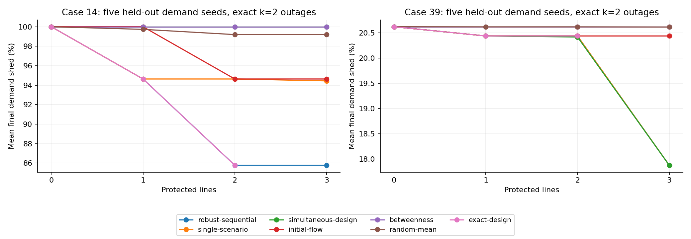
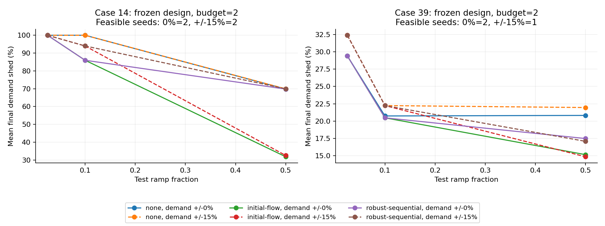
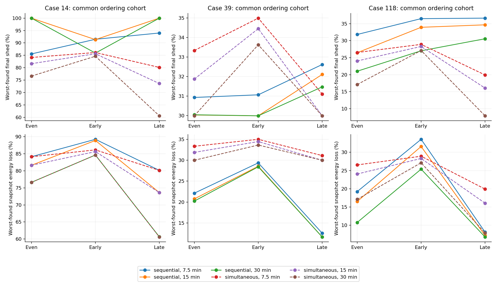
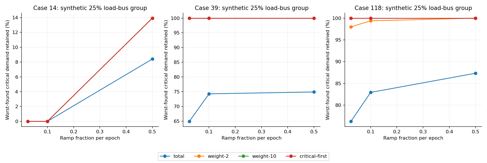

# SEQUIN: second-part evaluation report

Completed 27 October 2026. Scope: critique, three extensions, comparisons, sensitivity/robustness tests, demonstrations, measured conclusions and future work.

## 1. What was already accomplished and what was missing

| Requirement | Before this work | Completed in this work |
|---|---|---|
| Critique / limitations | Detailed source and modeling critique in notes/blueprint | Paper-linked critique, implications and extension mapping |
| 2-3 implemented extensions | One greedy protection prototype; timing multipliers; beam option | Scenario-aware protection, variable timing, critical-load response |
| Multiple baselines | One protection example with random/flow controls | Equal-budget random, flow, betweenness, simultaneous, single-scenario and exact designs; four service policies |
| Sensitivity / robustness | No complete extension study | Held-out demand seeds; shifted demand/ramp; budgets; timing horizons; priority/group-size sensitivity |
| Demonstration / explanation | Generic sequence viewer | Protection and timing traces; paired priority comparison; speaking guide |
| Conclusions / future work | Hypotheses, no consolidated extension findings | Measured improvements, ties, failures, limits and future work |

All 51 inherited tests passed before changes. New tests add exact-table equivalence, robust/outer-defense oracles, analytic priority service, timing accounting and a weighted-objective numerical regression. See the test record for the final suite result.

Inherited first-part reproduction outputs are preserved and labeled separately. Native Julia/Gurobi search remains license-dependent according to the saved audit; it is not required by any extension here. Full fresh paper reproduction is not claimed.

## 2. Critique and motivation

SEQUIN makes a useful contribution by identifying order-sensitive outages with stateful DC operator response and guided network screening. Its model does not select preparedness investments, treats served MW uniformly, and uses fixed response epochs. Candidate screening is heuristic; a prefix range is not a certificate over unseen continuations. Irreversible shedding and myopic dispatch can lock in choices that are poor for future failures. DC steady states also omit AC voltages, reactive power, relay/frequency behavior and transient stability.

These points motivate the three extensions below. Exact paper-page references, mathematical objectives, baseline definitions, sampling policies and novelty boundaries are in [the methods document](../../PART2_METHODS.md). Protection is already a topic in the broader literature; these are extensions relative to the selected SEQUIN workflow, not claims of entirely new research fields.

## 3. Extension 1: scenario-aware budgeted protection

Design on demand seeds 0/1/2; freeze decisions before testing seeds 100-104. Use cases 14/39, k=2, and budgets 0-3. Evaluate every eligible ordered pair exactly under the deterministic DC response policy, including an adaptive post-protection maximum. Greedy robust design minimizes the maximum design-scenario loss fraction; exact outer design verifies budgets 0-2. Twenty random defense orderings are averaged within each scenario, preserving demand scenario as the statistical unit.

The table reports five-test-seed means. Reduction is in percentage points of original demand, relative to no protection on the same scenario. Bootstrap intervals are descriptive with only five seeds.

| Case | Budget | Policy | Mean shed | Reduction pp | 95% bootstrap interval pp |
|---|---|---|---|---|---|
| 14 | 1 | robust-sequential | 94.63% | 5.37 | [0.00, 10.75] |
| 14 | 1 | initial-flow | 100.00% | 0.00 | [0.00, 0.00] |
| 14 | 1 | betweenness | 100.00% | 0.00 | [0.00, 0.00] |
| 14 | 1 | random-mean | 99.73% | 0.27 | [0.00, 0.54] |
| 14 | 1 | single-scenario | 94.63% | 5.37 | [0.00, 10.75] |
| 14 | 1 | simultaneous-design | 100.00% | 0.00 | [0.00, 0.00] |
| 14 | 1 | exact-design | 94.63% | 5.37 | [0.00, 10.75] |
| 14 | 2 | robust-sequential | 85.77% | 14.23 | [13.42, 15.09] |
| 14 | 2 | initial-flow | 94.63% | 5.37 | [0.00, 10.75] |
| 14 | 2 | betweenness | 100.00% | 0.00 | [0.00, 0.00] |
| 14 | 2 | random-mean | 99.20% | 0.80 | [0.00, 1.61] |
| 14 | 2 | single-scenario | 94.63% | 5.37 | [0.00, 10.75] |
| 14 | 2 | simultaneous-design | 100.00% | 0.00 | [0.00, 0.00] |
| 14 | 2 | exact-design | 85.77% | 14.23 | [13.42, 15.09] |
| 14 | 3 | robust-sequential | 85.77% | 14.23 | [13.42, 15.09] |
| 14 | 3 | initial-flow | 94.63% | 5.37 | [0.00, 10.75] |
| 14 | 3 | betweenness | 100.00% | 0.00 | [0.00, 0.00] |
| 14 | 3 | random-mean | 99.20% | 0.80 | [0.00, 1.61] |
| 14 | 3 | single-scenario | 94.44% | 5.56 | [0.00, 11.14] |
| 14 | 3 | simultaneous-design | 100.00% | 0.00 | [0.00, 0.00] |
| 39 | 1 | robust-sequential | 20.44% | 0.18 | [0.08, 0.27] |
| 39 | 1 | initial-flow | 20.44% | 0.18 | [0.08, 0.27] |
| 39 | 1 | betweenness | 20.62% | 0.00 | [0.00, 0.00] |
| 39 | 1 | random-mean | 20.62% | 0.00 | [0.00, 0.01] |
| 39 | 1 | single-scenario | 20.44% | 0.18 | [0.08, 0.27] |
| 39 | 1 | simultaneous-design | 20.44% | 0.18 | [0.08, 0.27] |
| 39 | 1 | exact-design | 20.44% | 0.18 | [0.08, 0.27] |
| 39 | 2 | robust-sequential | 20.44% | 0.18 | [0.08, 0.27] |
| 39 | 2 | initial-flow | 20.44% | 0.18 | [0.08, 0.27] |
| 39 | 2 | betweenness | 20.62% | 0.00 | [0.00, 0.00] |
| 39 | 2 | random-mean | 20.62% | 0.00 | [0.00, 0.01] |
| 39 | 2 | single-scenario | 20.44% | 0.18 | [0.08, 0.27] |
| 39 | 2 | simultaneous-design | 20.42% | 0.20 | [0.11, 0.27] |
| 39 | 2 | exact-design | 20.44% | 0.18 | [0.08, 0.27] |
| 39 | 3 | robust-sequential | 17.88% | 2.74 | [2.62, 2.83] |
| 39 | 3 | initial-flow | 20.44% | 0.18 | [0.08, 0.27] |
| 39 | 3 | betweenness | 20.62% | 0.00 | [0.00, 0.00] |
| 39 | 3 | random-mean | 20.62% | 0.01 | [0.00, 0.02] |
| 39 | 3 | single-scenario | 17.88% | 2.74 | [2.62, 2.83] |
| 39 | 3 | simultaneous-design | 17.88% | 2.74 | [2.62, 2.83] |

Case 14, budget 2: robust design protects [3, 4], reduces held-out mean loss by 14.23 percentage points (66.08 MW), versus 5.37 points for initial-flow protection. Its worst-design-scenario greedy gap to the exact outer optimum is 0.000000 percentage points.

Case 39, budget 2: robust design protects [14, 1], reduces held-out mean loss by 0.18 percentage points (18.50 MW), versus 0.18 points for initial-flow protection. Its worst-design-scenario greedy gap to the exact outer optimum is 0.000000 percentage points.

### Stress test and negative result

With design choices frozen, robust protection is worse than initial-flow protection in 11 of 42 feasible paired stress cells (cells are not independent samples). The largest excess loss is 39.90 percentage points at case/seed/ramp/perturbation/budget = ('14', '100', '0.5', '0.15', '2'). Scenario-aware design at one ramp setting does not establish robustness to changed operating flexibility. Separately, 18 requested stress policy rows have an infeasible fully served starting scenario; these are recorded explicitly and excluded from loss averages, without resampling or inventing a dispatch.

## 4. Extension 2: variable timing with matched observation horizons

Cases 14/39/118, three demand seeds, k=3, horizons 7.5/15/30 minutes, and even/early/late patterns. For each scenario, freeze the union of permutations of SEQUIN and flow-greedy outage sets. Both sequential and simultaneous comparators use the same windows, horizon and number of dispatch opportunities. The simultaneous set fails in the first window. Derived rates assume alpha=0.1 per five-minute reference epoch; they are experimental rates, not equipment measurements.

**The MWh result is a snapshot unserved-energy proxy.** Each response receives its window's ramp allowance, and its endpoint shed is charged over that whole window: sum(shed MW * window minutes / 60). No continuous ramp trajectory or intra-window service is simulated. This is a bounded discrete extension, not exact physical energy not served. Final MW and the MWh proxy answer different questions.

| Case | 15-minute pattern | Comparator | Mean cohort-worst final loss | Mean cohort-worst snapshot energy loss |
|---|---|---|---|---|
| 14 | even | sequential | 100.00% | 81.63% |
| 14 | even | simultaneous | 81.63% | 81.63% |
| 14 | early-cluster | sequential | 91.34% | 88.90% |
| 14 | early-cluster | simultaneous | 85.63% | 85.63% |
| 14 | late-cluster | sequential | 100.00% | 73.62% |
| 14 | late-cluster | simultaneous | 73.62% | 73.62% |
| 39 | even | sequential | 30.03% | 20.76% |
| 39 | even | simultaneous | 31.87% | 31.87% |
| 39 | early-cluster | sequential | 29.99% | 28.56% |
| 39 | early-cluster | simultaneous | 34.45% | 34.45% |
| 39 | late-cluster | sequential | 32.11% | 11.66% |
| 39 | late-cluster | simultaneous | 29.99% | 29.99% |
| 118 | even | sequential | 26.46% | 16.51% |
| 118 | even | simultaneous | 24.05% | 24.05% |
| 118 | early-cluster | sequential | 33.95% | 31.58% |
| 118 | early-cluster | simultaneous | 28.30% | 28.30% |
| 118 | late-cluster | sequential | 34.67% | 7.21% |
| 118 | late-cluster | simultaneous | 16.06% | 16.06% |

The final-loss maximum and energy-loss maximum can occur on different sequences. Values above average each scenario's cohort maximum across three seeds. Larger-case cohort maxima are not global worst-case certificates. Simultaneous and sequential event placement differs even after matching control opportunities; no universal ordering claim follows.

## 5. Extension 3: critical-service-aware response

Groups are synthetic random subsets of positive-load buses, fixed with group seed 17 and exported as original bus IDs. Compare total MW service, critical weights 2 and 10, and lexicographic critical-first service. All policies start from the same economic dispatch. The main ramp sweep uses a 25% group; 10% and 50% groups test size/composition sensitivity at nominal ramp. Different-size groups need not be nested, and only one assignment per size is tested. Three demand seeds per case are used.

Case 14 checks all 380 ordered pairs. Larger cases use a common union of sequences from three total-service searches plus SEQUIN under each priority policy (breadth 2); every policy is replayed on the full union. This is stronger than comparing separate policy-specific samples, but does not certify the worst critical-targeted attack in those larger networks.

| Case | Policy | Mean worst critical demand retained | Mean worst total shed MW | Coverage |
|---|---|---|---|---|
| 14 | total | 0.00% | 459.46 | exact pairs |
| 14 | weight-2 | 0.00% | 459.46 | exact pairs |
| 14 | weight-10 | 0.00% | 459.46 | exact pairs |
| 14 | critical-first | 0.00% | 459.46 | exact pairs |
| 39 | total | 74.29% | 2131.05 | shared cohort |
| 39 | weight-2 | 100.00% | 2133.72 | shared cohort |
| 39 | weight-10 | 100.00% | 2133.72 | shared cohort |
| 39 | critical-first | 100.00% | 2133.72 | shared cohort |
| 118 | total | 82.93% | 1085.85 | shared cohort |
| 118 | weight-2 | 99.37% | 1075.90 | shared cohort |
| 118 | weight-10 | 100.00% | 1095.15 | shared cohort |
| 118 | critical-first | 100.00% | 1096.93 | shared cohort |

Across 6,197 paired sequence/configuration rows, weight-2 improves critical service in 2,448, worsens final critical service in 40, and increases total shed in 1,459, using a 0.001 MW change threshold. These counts describe deterministic repeated evaluations, not independent statistical observations. Myopic priority choices are not a guarantee about later service.

Across 6,197 paired sequence/configuration rows, weight-10 improves critical service in 2,986, worsens final critical service in 68, and increases total shed in 2,067, using a 0.001 MW change threshold. These counts describe deterministic repeated evaluations, not independent statistical observations. Myopic priority choices are not a guarantee about later service.

Across 6,197 paired sequence/configuration rows, critical-first improves critical service in 2,974, worsens final critical service in 82, and increases total shed in 2,086, using a 0.001 MW change threshold. These counts describe deterministic repeated evaluations, not independent statistical observations. Myopic priority choices are not a guarantee about later service.

The illustrative paired demo uses case 39, demand seed 1, ramp 0.1, sequence [14, 37], and synthetic critical buses [1, 3, 4, 8, 12, 16, 18, 20, 23, 26, 28]. Critical-first retains 1676.64 MW more critical service; total shed changes by +957.25 MW. This example was selected for its largest observed critical gain and is explicitly not a representative average.

[Open the paired comparison](demo_critical/comparison.html), [total-service trace](demo_critical/total.html), or [critical-first trace](demo_critical/critical-first.html).

## 6. Validation, reproducibility and artifacts

Saved rows: 1,648 main protection, 144 requested protection stress (126 feasible), 1,620 timing, and 24,788 priority evaluations. Maximum reported primal/bound/integrality residual over the exported feasible evaluation rows is 1e-08 per-unit, below the simulator acceptance threshold of 2e-6. The largest recorded normalized priority-service floor tolerance is 6.55e-06 p.u. A full raw-data audit independently replays selected results and checks cohort pairing and energy arithmetic.

Run `.venv/Scripts/python.exe -m pytest -q`, then `.venv/Scripts/python.exe scripts/run_part2.py`, then `.venv/Scripts/python.exe scripts/build_part2_report.py`. The suite supports separate protection/timing/priority/report phases and checkpoints exact oracle tables. Dependencies and source/scenario fingerprints are saved. Timings collected with concurrent processes are functional compute measurements, not controlled runtime comparisons with the paper.

Raw files: [protection](protection.csv), [defense designs](defense_designs.json), [stress tests](protection_sensitivity.csv), [timing](timing.csv), [priority](priority.csv), [critical groups](critical_groups.json), [analysis](summary.json), [run manifest](run_manifest.json), and exact tables in `oracles/`. See [the demonstration guide](../../PART2_DEMO_GUIDE.md), [test record](validation.json), and [independent data audit](data_audit.json). Core and transitive dependency versions are pinned in [the extension lock file](../../requirements-part2-lock.txt).

[Protection demo: case 14](demo_protection_14.html), [protection demo: case 39](demo_protection_39.html), [timing demo](demo_timing/viewer.html), and [critical-service paired comparison](demo_critical/paired_comparison.json).

## 7. Conclusions and future work

The second-part work is implemented and evaluated within the stated scope. Adaptive protection can improve tested resilience, but nominal scenario robustness does not imply robustness to changed ramp flexibility. Timing patterns and observation windows change the measured consequences, so MW and snapshot-weighted MWh must be kept separate. Critical-first operation can retain important synthetic service while shifting loss to other consumers; myopic operation and severe isolation still limit what priorities can achieve. Saturation and ties are valid negative results.

Next steps are joint demand/ramp scenario design; nonuniform protection costs and imperfect hardening; larger-k independent outage searches; physical ramp trajectories and calibrated observation times; critical-demand fractions within a bus; storage with state of charge; restoration and reconnection; and AC/transient validation. Stronger claims require more held-out scenarios, actual critical-facility data and operational validation.

## Sources and attribution

Selected paper: Chio et al., ICCPS 2025, [DOI](https://doi.org/10.1145/3716550.3722029). [Authors' implementation](https://github.com/andrewgchio/SEQUIN). Related protection model: Mastin et al., [Best Response Intersection](https://pubsonline.informs.org/doi/abs/10.1287/ijoo.2022.0081). The full critique and source interpretation are documented in [PART2_METHODS](../../PART2_METHODS.md). All measured extension results are from the independent Python/HiGHS model.
